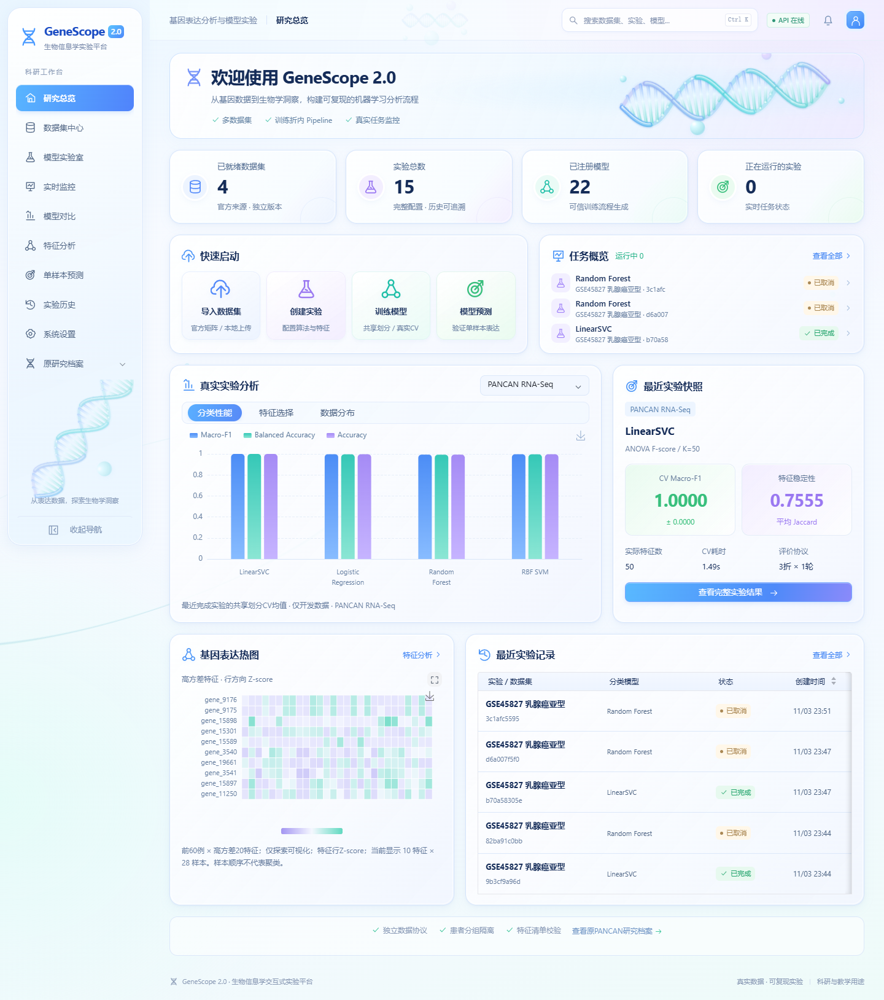

# GeneScope 2.0

**可在本机运行的基因表达分析与机器学习实验平台。线上网站不可访问时，仍可在自己的电脑使用。**

数据集管理 → 模型配置 → 真实CV训练 → 实时监控 → 结果比较 → 单样本预测。React / TypeScript / Arco / ECharts 前端，FastAPI 与受监督Python计算进程。

[下载本地运行包](https://github.com/wujiangbin0604-cmyk/bioproject/releases/latest) · [本地安装与使用](docs/LOCAL_USE.md) · [数据集指南](DATASET_GUIDE.md) · [命令行/API](API_GUIDE.md) · [科研复现](docs/RESEARCH_REFERENCE.md)



截图来自已导入数据的实际环境。首次下载不携带原始表达矩阵、其他人的实验记录或动态注册模型；这些内容由你在本机导入和生成。

新安装的空缓存状态见[首次启动截图](docs/screenshots/genescope2-first-open.png)。

## 最快开始：下载后在本地打开

1. 安装 **Python 3.14.0**（可完整使用仓库中的冻结M1）。
2. 在 [Releases](https://github.com/wujiangbin0604-cmyk/bioproject/releases/latest) 下载 `GeneScope2-local-v2.0.1.zip`，完整解压到可写目录。
3. Windows双击 **`start_local.cmd`**。首次会创建项目虚拟环境并安装依赖，然后打开本机工作台。
4. 浏览器访问 **http://127.0.0.1:8787**。关闭启动终端或按 `Ctrl+C` 停止服务。

成品包已包含编译后的前端，**运行时不需要Node、Docker、云服务器或网站账号**。首次安装Python依赖和下载官方数据需要网络；依赖与数据准备好后可离线使用。离线安装方法见[本地指南](docs/LOCAL_USE.md#完全离线安装)。

macOS/Linux在解压目录执行：

```bash
sh start_local.sh
```

也可在已有兼容Python环境中启动：

```bash
python genescope.py setup
python genescope.py
```

## 从GitHub源码运行

源码版第一次需要Node.js/npm构建前端，本项目已在Node24验证。安装Python后执行：

```bash
git clone https://github.com/wujiangbin0604-cmyk/bioproject.git
cd bioproject
python genescope.py setup
python genescope.py
```

`setup`会创建`.venv-local`、安装锁定运行依赖并执行`npm ci`及前端生产构建。后续启动直接使用本地前端成品，不启动Vite开发服务器。

## 首次打开后能做什么

| 功能 | 新下载包的状态 / 下一步 |
|---|---|
| 本地工作台、配置与界面 | 可直接打开；无需访问线上GeneScope |
| 冻结M0–M5推理 | 包含六个原可信工件；M1同时提供命令行入口；使用精确Python3.14.0和锁定依赖 |
| GEO数据集与新模型训练 | 在数据集中心下载/上传官方Series Matrix，导入后创建实验 |
| PANCAN训练 | 另行准备原始CSV或合法研究数据位置；复用原固定640/161划分 |
| 新实验、模型、结果导出 | 本机运行后生成并持久保存 |
| 原研究历史图表 | 源码包不附带完整`results/`；复现或导入已有合规结果后显示 |

建议先导入 **GSE45827**，创建一个 `LinearSVC + ANOVA Top20 + 3折CV` 实验，完成后查看比较、特征与预测。标签、数据处理和评价范围见[数据集指南](DATASET_GUIDE.md)。

## 不打开浏览器也能使用

```bash
python genescope.py doctor
python genescope.py verify
python genescope.py data gse45827 --download
python genescope.py predict --input deployment/examples/sample_input.csv --output prediction.json
```

仓库自带的`sample_input.csv`是**合成格式示例**，用于验证完整列名和调用流程，预测输出不具有生物学意义。正式推理需使用与模型相同数据集、相同表达尺度的真实单样本CSV。

## 文档导航

| 目的 | 文档 |
|---|---|
| 本地运行、离线安装、端口、常见错误 | [LOCAL_USE](docs/LOCAL_USE.md) |
| 官方数据来源、纳入规则、特征和分组 | [DATASET_GUIDE](DATASET_GUIDE.md) |
| API和调用示例 | [API_GUIDE](API_GUIDE.md) |
| 前端开发、双终端模式 | [WEB_DEVELOPMENT](WEB_DEVELOPMENT.md) |
| 原始研究和全部复现命令 | [RESEARCH_REFERENCE](docs/RESEARCH_REFERENCE.md) |
| M1命令行输入/模型校验 | [deployment/README](deployment/README.md) |
| 更新记录、贡献、许可状态 | [CHANGELOG](CHANGELOG.md) · [CONTRIBUTING](CONTRIBUTING.md) · [LICENSE_PENDING](LICENSE_PENDING.md) |
| 自己部署服务器 | [服务器部署](cloud_deployment/GENESCOPE2_SERVER.md) |

## 目录

```text
genescope.py / start_local.*  本地启动、安装、诊断和CLI入口
local_runtime/               同端口前端/API入口及包校验
frontend/                    React工作台；Release附带dist成品
backend/                     原API、导入、真实任务和模型注册
deployment/                  原冻结M1、可信加载器、合成格式示例
datasets/registry.json       四数据集定义；下载内容保存在本机
docs/                       使用指南、研究说明和实际截图
scripts/build_local_bundle.py  从已审查Git内容构建本地运行包
```

源码中的根目录科研脚本继续保留原模块名与接口；详细作用见科研复现文档。

科研与教学用途。模型输出是特定数据集中的类别预测，不是患癌风险、早筛或临床诊断。项目许可状态见`LICENSE_PENDING.md`，依赖声明保留在前端与部署目录。
